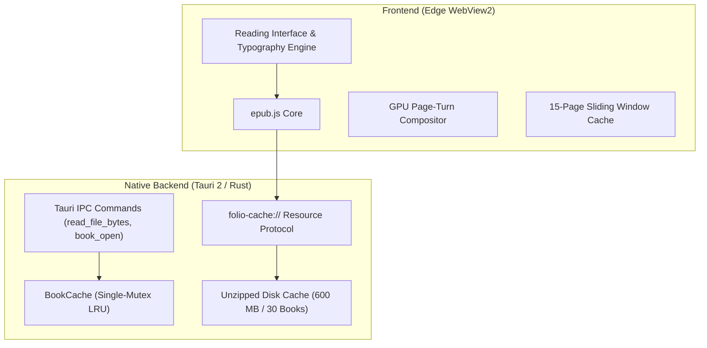

# Folio — A Beautiful Reading Experience for Windows

> **Folio** is a beautifully crafted, offline-first ebook reader for Windows (supporting EPUB, MOBI, and AZW3), built with Tauri, Rust, WebView2 and epub.js. Featuring realistic page-turn animations, refined typography, immersive reading environments, botanical page ornaments, annotations, bookmarks, full-book search and neural text-to-speech. Designed to recreate the pleasure of reading a beautifully printed physical book.

Folio is a desktop ebook reader designed around a simple idea: reading a digital book should feel as comfortable, immersive and beautiful as reading a well-crafted physical book.

Built with Tauri 2, Rust, WebView2 and epub.js, Folio combines a lightweight native desktop application with a carefully designed reading interface. Rather than treating an ebook as just another document displayed on a screen, Folio recreates the visual experience of a traditional book — from carefully tuned typography and realistic page turns to textured paper, elegant book stands, decorative chapter openings and botanical page ornaments.

### What makes Folio different?
- **Format versatility**: Native support for DRM-free **EPUB**, **MOBI** (Mobi 6/7), and **AZW3 / KF8** ebooks.
- **A book-like reading experience**: Realistic page-fold animations, single-page and two-page layouts, and carefully tuned typography.
- **Beautiful reading environments**: Choose from curated paper, ink and desk themes, with independent control over the surrounding Reading Room.
- **Decorative book aesthetics**: Chapter-opening ornaments, botanical side vines, gold corner decorations and traditional book-inspired details.
- **A comfortable reading interface**: Adjustable fonts, line spacing, page width, margins, reading ruler and focus-friendly controls.
- **Tools for serious readers**: Bookmarks, highlights, annotations, full-book search, dictionary lookup and reading statistics.
- **Read aloud**: System voices and optional offline neural text-to-speech.
- **Local-first design**: Your books and reading experience are designed to work without depending on a cloud service.


## Downloads

Download the latest release for Windows 10/11 (64-bit):

- **[Download Windows Setup (.exe)](https://github.com/your-org/folio/releases/latest)** — Recommended installer (~15 MB).
- **[Download Windows MSI (.msi)](https://github.com/your-org/folio/releases/latest)** — Enterprise / silent installation package.
- **[Download Standalone Executable](https://github.com/your-org/folio/releases/latest)** — Portable binary without setup (~9 MB).

*Note: Folio is offline-first. All core fonts and readers are bundled locally. Optional Kitten neural TTS voices (~92 MB) install once on-demand from settings, then work completely offline.*

## Architecture Overview

Folio marries a low-overhead Rust native host with an Edge WebView2 reading canvas:



- **Native Rust Host (Tauri 2)**: Manages file associations, single-instance routing (forwarding secondary launches to the active window), zip-slip safe unpacking, memory-budgeted LRU cache, and disk cache maintenance.
- **Custom `folio-cache://` Protocol Handler**: High-throughput content-addressed cache protocol that serves pre-extracted book assets directly to WebView2 with immutable HTTP caching and automatic XML entity repair.
- **Composited Page-Turn Engine**: Smooth GPU-accelerated page flips animating only `transform` and `opacity` properties with forced GPU rasterization.

## Screenshots

| Reading Room (Royal Maroon) | Two-page spread |
|---|---|
|  |  |

| Landing | Single page |
|---|---|
|  |  |

| Contents drawer | Typography & settings |
|---|---|
|  |  |

| Keyboard shortcuts | Velvet Night theme |
|---|---|
|  |  |

## Reading Environments

Seven curated environments, each with its own desk, cloth, and side-vine dressing — captured live with per-chapter page art:

| Natural Paper | Modern Clean |
|---|---|
|  |  |

| Velvet Night | Aizome |
|---|---|
|  |  |

| Ember | Velvet |
|---|---|
|  |  |

| Emerald | |
|---|---|
|  | |

## Features

### Implemented Features

#### Getting Books In
- **Open any DRM-free EPUB 2/3** (reflowable) — native file picker (`Ctrl+O`), drag & drop onto the window, double-click via Windows `.epub` file association, or CLI argument. A second launch forwards its file to the running window instead of spawning a duplicate.
- **Built-in sample book** — embedded abridgement of *The Time Machine* for an instant first-run experience.
- **Recent shelf with cover thumbnails** and "Continue reading" resume button (restores exact position via CFI).
- **Fast re-opens** — books are decompressed once into a zip-slip-safe Rust-side disk cache served over a custom `folio-cache://` protocol (600 MB / 30-book LRU eviction), with single-mutex raw binary IPC for first loads.
- **Offline-first operation** — epub.js, JSZip, Space Grotesk UI font, and all reading fonts are bundled locally.

#### Reading Experience
- **Auto-fit typography** — page width (460–2000 px) and font size (15–28 px, 0.1 steps) with auto-fit; typographic harmony engine tunes line height, letter/word spacing, and margins to hold ~68 characters per line.
- **Four bundled reading typefaces** — Literata, Lexend, Atkinson Hyperlegible, and OpenDyslexic (local WOFF2), plus justified text, drop caps, and bionic reading (bold word prefixes).
- **Seven curated reading environments** — Natural Paper, Modern Clean, Velvet Night, Aizome, Ember, Velvet, and Emerald; manual theme pick or auto day/night following the OS, plus a warmth (blue-light) slider.
- **Per-book typography memory** — each book remembers its own custom settings.
- **Paper-grade page turns** — GPU-composited fold-sheet flip (paper texture, warm fold light, crease sheen, damped-spring physics, drag-to-turn with fling) plus slide and instant FX modes, and toggleable page-turn sound.
- **Reading ruler** — guide line following pointer for focus reading.

#### Reading Room & Page Ornamentation
- **Two-axis theming** — pick your paper environment (fonts, ink, page tone) and your **Reading Room** (the desk the book rests on) independently. Royal Maroon leads the set: burgundy damask wallpaper, gilt book stand, and embossed cover lettering.
- **Per-chapter page art** — chapter openings feature gold corner frames and headpieces; continuation pages carry small fleurons. Twelve gold corner designs are assigned deterministically per chapter.
- **Side vines** — botanical columns (three designs with true left/right pairs) climbing the desk margins.
- **Inside-page margins** — independent top/bottom/side sliders that reserve empty space around the text block without disturbing pagination.

#### Layout, Navigation & Progress
- **Single page / two-page spread** (`D`) — auto (width-based), forced on, or off, with independent width memory per mode.
- **Running header** with chapter / book title above the page.
- **Table of contents** (`T`) with windowed rendering for large TOCs and current-chapter marking.
- **Progress tracking** — draggable progress rail with page-granularity scrubbing, preview card (chapter, page, excerpt), safety anchor ("Return to Page X"), top chapter ribbon, book-wide page numbers, and time-left estimates.
- **Chapter navigation ribbons** on screen edges for previous/next chapter (`[` / `]`).
- **Bookmarks** (`B`) per book with badge count, plus middle-click auto-scroll and mouse-wheel page turning.

#### Highlights, Notes & Lookup
- **Highlights in four colors** with click-to-annotate notes, persisted per book; export notes as Markdown.
- **Full-book search** (`Ctrl+F`) with excerpt highlighting and jump-to-match.
- **Word definitions** on selection with offline cache for previously fetched words.

#### Read Aloud & Reading Stats
- **Text-to-speech, two engines** — *System voices* (OS-provided) and *Kitten neural* (offline neural voice engine). Play/pause (`R`), stop (`Shift+R`), speed (`-` / `=`), sentence highlighting, and auto page advance.
- **Reading stats** — session/day minutes, pages turned, and streak tracker on the landing page.

#### Chrome & Polish
- **Auto-hiding chrome** (3.4 s) and fullscreen (`F`); footnote popups, image lightbox/zoom, and keyboard-shortcuts overlay (`?`).

### Planned Features (Roadmap)
- [ ] Modular frontend refactoring (separating single-file reader into ES modules for page turn engine, settings, and annotations).
- [ ] IndexedDB storage engine for bookmarks, highlights, and reading stats with automated schema migrations.
- [ ] Adaptive preloading window tuning based on device memory and reading speed.
- [ ] Offline dictionary bundle (StarDict / Wiktionary integration) eliminating the online definition API dependency.
- [ ] Touch gesture refinements for tablet and foldable Windows devices.

## Keyboard Shortcuts

| Keys | Action |
|---|---|
| `→` / `Space` / `PgDn` · `←` / `PgUp` | Next / previous page |
| `T` · `S` | Contents · Typography settings |
| `B` / `Ctrl+B` | Bookmark this page |
| `Ctrl+F` | Search this book |
| `G` · `D` · `V` | Reading guide · one/two-page layout · page-turn effect |
| `F` · `H` | Full screen · Home / continue reading |
| `R` / `Shift+R` · `-` / `=` | Read aloud pause/stop · speed |
| `Ctrl+O` | Open an EPUB file |
| Mouse wheel · `Ctrl+Wheel` · `Alt+Wheel` | Turn pages · type size · page width |
| Middle-click | Auto-scroll |
| `[` / `]` | Previous / next chapter |
| `?` / `Esc` | Show / hide help / close panels |

## Building & Running

### Requirements
- [Node.js](https://nodejs.org/) (v18+)
- [Rust](https://www.rust-lang.org/) (2021 edition)
- Windows 10/11 with WebView2 runtime (pre-installed on Windows 10 2004+ and Windows 11)

### Development

```powershell
cd tauri_epub_reader

npm run dev          # launches Tauri development window with hot reload
npm run build        # compiles release executable and installers
```

### Running Tests

```powershell
npm test             # runs all Rust unit tests and Playwright e2e suites
npm run test:rust    # runs Rust unit tests only (BookCache, zip protection, protocol)
npm run test:e2e     # runs Playwright browser test suite (serves src/ on port 8124)
```

## Project Structure

```
├── docs/
│   └── screenshots/               # Application screenshots
└── tauri_epub_reader/
    ├── README.md                  # App-level development documentation
    ├── docs/
    │   ├── DESIGN_AND_LLD.md      # Low-Level Design (LLD) and system specifications
    │   ├── FEATURES.md            # Detailed feature tracking
    │   └── DESIGN-IMPROVEMENTS.md # Visual benchmarks and performance design
    ├── src/                       # Frontend source (offline-bundled epub.js, JSZip, fonts)
    ├── src-tauri/                 # Tauri Rust backend (IPC, single-mutex cache, folio-cache:// protocol)
    └── tests/                     # Playwright e2e test suite & manual visual validation
```
