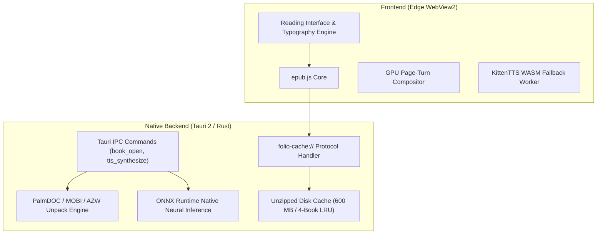

<p align="center">
  
</p>

<h1 align="center">Aurefolia — A Beautiful Reading Experience</h1>

<p align="center">
  <strong>An offline-first, beautifully crafted desktop ebook reader for Windows and macOS.</strong>
  <br>
  Supporting <b>EPUB 2/3, MOBI, AZW, and AZW3</b> with realistic page turns, refined typography, botanical page ornaments, neural text-to-speech, and immersive reading environments.
</p>

<p align="center">
  <a href="https://github.com/rtshiva/folio_ebook_reader/actions/workflows/build-installers.yml"></a>
  <a href="https://github.com/rtshiva/folio_ebook_reader/releases/latest"></a>
  
  
</p>

---

Aurefolia is designed around a simple conviction: **reading a digital book should feel as comfortable, immersive, and visually tactile as reading a finely printed volume.**

Built with **Tauri 2**, **Rust**, **WebView2**, and **epub.js**, Aurefolia pairs a low-overhead native backend with a bespoke reading canvas. Rather than presenting ebooks as sterile documents, Aurefolia recreates the physical intimacy of reading — from spring-physics page turns and textured paper stock to decorative chapter openings, botanical margin vines, and full-book neural text-to-speech.

### What makes Aurefolia unique?
- **Universal reflowable format support**: DRM-free **EPUB 2/3**, **MOBI** (Mobi 6/7/PalmDOC), **AZW**, and **AZW3 / KF8**.
- **Tactile page turns**: GPU-accelerated fold-sheet page flips with paper texture, crease sheen, warm fold light, and damped-spring drag physics.
- **Dual-axis reading aesthetics**: Independent selection of your paper/ink environment and your surrounding **Reading Room** desk wallpaper.
- **Botanical ornamentation**: Chapter-opening headpieces, gold corner cartouches, fleuron chapter continuation markers, and climbing margin vines.
- **Refined typography harmony**: Auto-fitting layout targeting ~68 characters per line with bundled typefaces (Literata, Lexend, Atkinson Hyperlegible, OpenDyslexic), drop caps, and bionic reading.
- **Neural Read Aloud (KittenTTS)**: High-fidelity offline neural voice synthesis powered by native multi-threaded ORT inference with fallback to WebAssembly.
- **Local-first privacy**: Zero telemetry, no cloud accounts, and fully offline operation.


## Downloads

Download the latest release from the **[GitHub Releases Page](https://github.com/rtshiva/folio_ebook_reader/releases/latest)**:

### Windows (64-bit)
- **[Windows NSIS Setup (.exe)](https://github.com/rtshiva/folio_ebook_reader/releases/latest)** — Recommended desktop installer with Start Menu integration and file associations.
- **[Windows MSI Installer (.msi)](https://github.com/rtshiva/folio_ebook_reader/releases/latest)** — Standard Windows Installer package for managed/enterprise environments.
- **[Standalone Portable Executable (.exe)](https://github.com/rtshiva/folio_ebook_reader/releases/latest)** — Single self-contained binary (`Aurefolia.exe`) without installation.

### macOS (Apple Silicon arm64)
- **[macOS Disk Image (.dmg)](https://github.com/rtshiva/folio_ebook_reader/releases/latest)** — Drag-and-drop installer for Apple Silicon (M1/M2/M3/M4) Macs.
- **[macOS Application Tarball (.app.tar.gz)](https://github.com/rtshiva/folio_ebook_reader/releases/latest)** — Portable application bundle archive.

> [!NOTE]
> **macOS Gatekeeper notice**: macOS builds are currently unsigned. On first launch, right-click the application and select **Open** (twice), or run `xattr -cr "/Applications/Aurefolia.app"` in Terminal to clear the quarantine attribute.

### Nightly CI builds (from `main`)

Every successful push to `main` republishes a rolling **[nightly prerelease](https://github.com/rtshiva/folio_ebook_reader/releases/tags/nightly)** with fixed asset names, so these links always serve the newest CI build:

- **[Aurefolia-nightly.exe](https://github.com/rtshiva/folio_ebook_reader/releases/download/nightly/Aurefolia-nightly.exe)** — portable executable
- **[Aurefolia-nightly-setup.exe](https://github.com/rtshiva/folio_ebook_reader/releases/download/nightly/Aurefolia-nightly-setup.exe)** — NSIS installer
- **[Aurefolia-nightly.msi](https://github.com/rtshiva/folio_ebook_reader/releases/download/nightly/Aurefolia-nightly.msi)** — MSI installer

Or fetch them from the command line — nightly downloads need no auth (the repo is public):

```bash
node scripts/fetch-latest-ci.mjs            # nightly release, or latest artifact as fallback
node scripts/fetch-latest-ci.mjs --dry-run  # list what it would download
npm run fetch:ci                            # same, from tauri_epub_reader/
```

> [!NOTE]
> The artifact fallback (when no nightly release exists) uses the Actions API, which GitHub requires authentication for even on public repos — set `GITHUB_TOKEN` (or `GH_TOKEN`) for that source.

Per-run artifacts (including PR builds) remain downloadable for 30 days from each [Actions run page](https://github.com/rtshiva/folio_ebook_reader/actions/workflows/build-installers.yml).

---

## Architecture Overview

Aurefolia marries a security-hardened native Rust host with an Edge WebView2 reading canvas:



- **Native Rust Host (Tauri 2)**: Handles window management, Windows & macOS file associations, single-instance routing (forwarding secondary file launches to the running window), and decompression bounds.
- **Custom `folio-cache://` Protocol**: High-throughput content-addressed cache protocol that serves pre-extracted book assets directly to WebView2 with strict Content Security Policies (`script-src 'none'`) and XML entity repair.
- **Native Neural TTS (ONNX Runtime)**: Multi-threaded native synthesis with sub-0.20 RTF (Real-Time Factor), volume-bounded PCM chunking, and fallback to WebAssembly in browser contexts.
- **GPU Page-Turn Compositor**: Pure `transform` and `opacity` shader animations that eliminate layout thrashing during page flips.

---

## Screenshots

Every screenshot below shows a real book fetched from [Project Gutenberg](https://www.gutenberg.org/) — no mock-ups.

| Reading Room (Royal Maroon) | Two-Page Spread |
|---|---|
|  |  |

| Library Landing | Single Page Reading |
|---|---|
|  |  |

| Table of Contents | Typography & Reader Settings |
|---|---|
|  |  |

| Keyboard Shortcuts Overlay | After Dark (theme auto) |
|---|---|
|  |  |

---

## Reading Environments

Seven curated environments, each with its own desk tone, cloth texture, and side-vine dressing — shown here with four classics from Project Gutenberg:

| Natural Paper | Modern Clean |
|---|---|
|  |  |

| Velvet Night | Aizome |
|---|---|
|  |  |

| Ember | Velvet |
|---|---|
|  |  |

| Emerald | |
|---|---|
|  | |

---

## Core Features

### Format Support & Ingestion
- **Formats**: Reflowable DRM-free **EPUB 2/3**, **MOBI** (Mobi 6/7/PalmDOC), **AZW**, and **AZW3 / KF8**.
- **Launch Vectors**: Native file dialog (`Ctrl+O`), drag & drop, CLI file arguments, and OS file association double-clicks with single-instance forwarding.
- **Decompression Safety**: Path traversal protection against Zip-Slip attacks, NTFS alternate data stream filters, and PalmDOC decompression byte quotas (256 MB bounds).
- **Recent Books Shelf**: Persistent reading shelf with cover thumbnails, read percentage, and exact CFI location restore.

### Reading Engine & Typography
- **Harmonic Typography**: Continuous slider control over font size (15–28 px), line height (1.2–2.2), page width (460–2000 px), and side/inside margins.
- **Embedded Offline Fonts**: Literata, Lexend, Atkinson Hyperlegible, OpenDyslexic, and Space Grotesk UI.
- **Page Presentation**: Single-page and dual-page spread (`D`), justified alignment, drop caps, bionic reading (bold word prefixes), and reading ruler/guide.
- **Per-Book Preferences**: Remembers independent typography, layout, and zoom preferences per title.

### Navigation, Bookmarks & Annotations
- **Progress Tracking**: Scannable progress bar, chapter ribbons, live reading percentage, time remaining, and page scrub preview.
- **Chapter Navigation**: Fixed or auto-hiding previous/next chapter hover panels with proximity protection.
- **Bookmarks & Highlights**: Four highlight colors, inline annotations, persistent per-book bookmark shelf, and one-click Markdown export.
- **Full-Text Search (`Ctrl+F`)**: Instant in-book full search with excerpt highlighting and jump-to-location.
- **Offline Dictionary**: Word selection definition popover with offline local caching.

### Neural Read Aloud (TTS)
- **Engine Options**: Native **KittenTTS neural voices** via local ONNX runtime (~78 MB bundled model) with thread-count clamping, or standard system voices (`speechSynthesis`).
- **Playback Controls**: Play/pause (`R`), stop (`Shift+R`), variable speed (0.5x–2.0x), synchronized sentence highlighting, and seamless cross-chapter advance.

---

## Keyboard Shortcuts

| Keys | Action |
|---|---|
| `→` / `Space` / `PgDn` | Next page |
| `←` / `PgUp` | Previous page |
| `Alt + ←` / `Alt + →` | Back / forward after a jump (TOC, search, links) |
| `[` / `]` | Previous / next chapter |
| `D` | One / two page layout |
| `T` | Contents & bookmarks drawer |
| `S` | Typography & settings drawer |
| `Ctrl + F` | Search this book |
| `B` / `Ctrl + B` | Bookmark this page |
| `R` / `Shift + R` | Read aloud: pause / stop |
| `-` / `=` | Read aloud speed |
| `V` | Page-turn effect (narrator voice during read aloud) |
| `F` | Full screen |
| `H` | Home / continue reading |
| `G` | Reading guide |
| `Ctrl + O` | Open ebook file |
| `Mouse Wheel` | Turn pages (including inside page frames) |
| `Ctrl + Wheel` / `Alt + Wheel` | Adjust font size / page width |
| `Middle Click` | Toggle auto-scroll |
| `?` / `Esc` | Help overlay / close active drawers |

---

## Development & Building

### Prerequisites
- [Node.js](https://nodejs.org/) (v20+)
- [Rust](https://www.rust-lang.org/) (1.77.2+)
- Windows 10/11 with WebView2 runtime, or macOS 12+ (Apple Silicon)

### Commands

All development tasks run from the `tauri_epub_reader` directory:

```bash
cd tauri_epub_reader

# Install dependencies
npm ci

# Run development mode with hot reload
npm run dev

# Run full test suite (Rust unit tests, static scan, Playwright e2e)
npm test

# Run Rust unit and security tests (68 tests)
npm run test:rust

# Run static invariant & security scan (42 checks)
npm run scan

# Run ESLint over the frontend sources (CI also runs Clippy with -D warnings)
npm run lint

# Build standalone executable & installers
npm run build
```

Compiled desktop binaries are produced in `tauri_epub_reader/src-tauri/target/release/`:
- `app.exe` (Windows standalone binary)
- `bundle/nsis/Aurefolia_1.0.0_x64-setup.exe` (NSIS setup installer)
- `bundle/msi/Aurefolia_1.0.0_x64_en-US.msi` (MSI installer)

---

## Test & Verification Standards

Aurefolia maintains an uncompromising test and security posture:
- **68 Rust Unit & Security Tests**: Full coverage for PalmDOC compression/decompression, Zip-Slip prevention, XML entity repairs, CORS isolation, cache bounds, and eviction safety.
- **42 Invariant Static Scan Checks**: Enforces IPC conversion safety, origin reflection, theme agreement, reading font embedding, and sanitized DOM insertion.
- **Zero Clippy Warnings**: Strict `-D warnings` enforcement across all platforms and compilation targets.
- **Clean Dependency Audit**: Zero high or critical vulnerabilities across npm and Cargo packages.

---

## Repository Structure

```
├── resources/
│   └── app-icon/                  # Master icon set, ICO, multi-res PNGs, and source archive
├── design-sources/
│   └── raw-assets/                # Raw vector ornaments, EPS backgrounds, and design assets
├── docs/
│   ├── CODE_REVIEW_GUIDE.md       # Comprehensive code review standards
│   ├── app-icon.png               # High-resolution application icon
│   └── screenshots/               # Application captures across themes and layouts
└── tauri_epub_reader/
    ├── src/                       # Frontend web application (offline-bundled JS, fonts, CSS)
    │   ├── assets/                # App icon, tiles, and SVG ornaments
    │   ├── vendor/                # epub.js, jszip, and bundled font files
    │   └── index.html             # Unified reader shell
    ├── src-tauri/                 # Rust backend (Tauri 2 host)
    │   ├── icons/                 # Platform icons (.ico, .icns, tile PNGs)
    │   ├── models/                # KittenTTS ONNX neural voice model
    │   ├── src/
    │   │   ├── lib.rs             # Tauri commands, cache manager & folio-cache:// protocol
    │   │   └── mobi.rs            # MOBI / PalmDOC / AZW parsing & extraction
    │   └── tauri.conf.json        # Window definitions, bundle targets, security CSP
    └── tests/                     # Playwright end-to-end and static scan test suites
```

---

## License

This project is licensed under the [MIT License](LICENSE).
