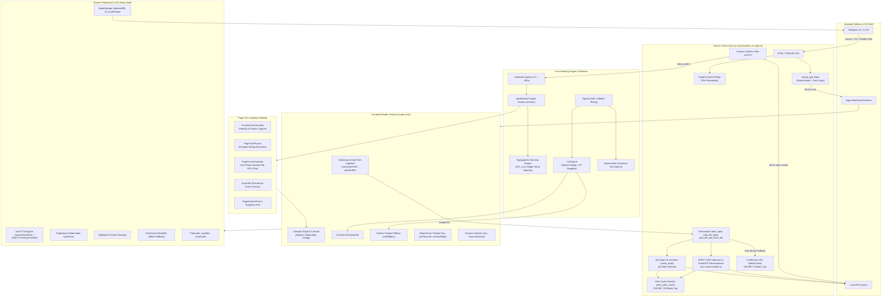
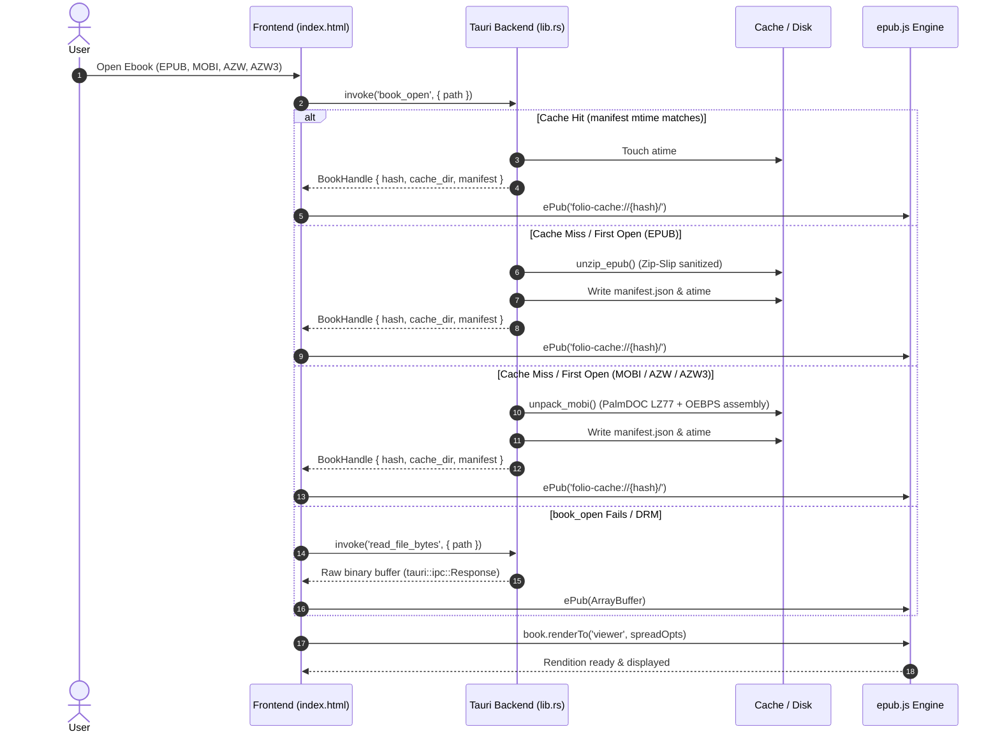
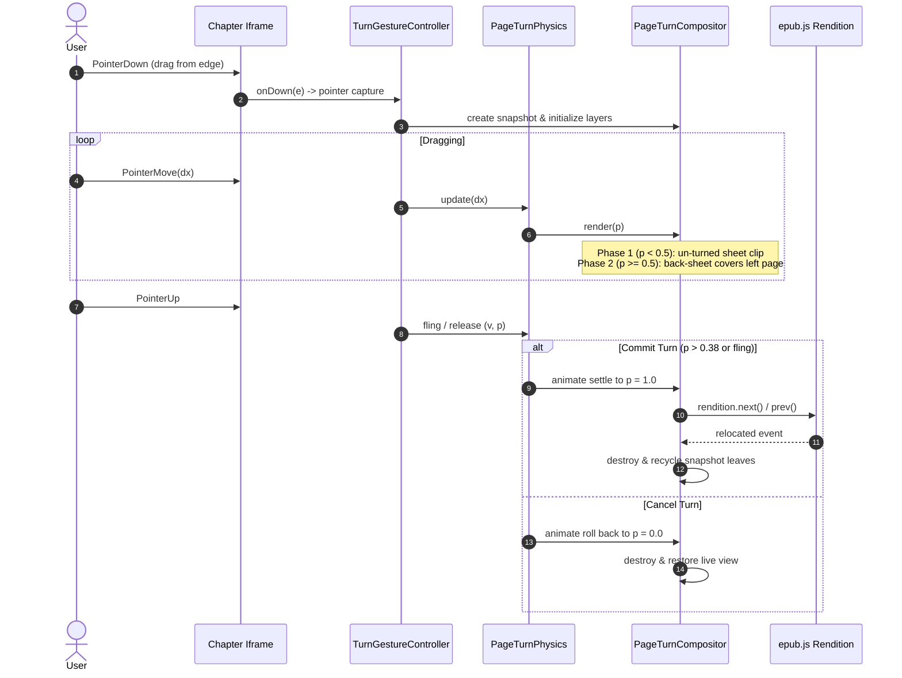
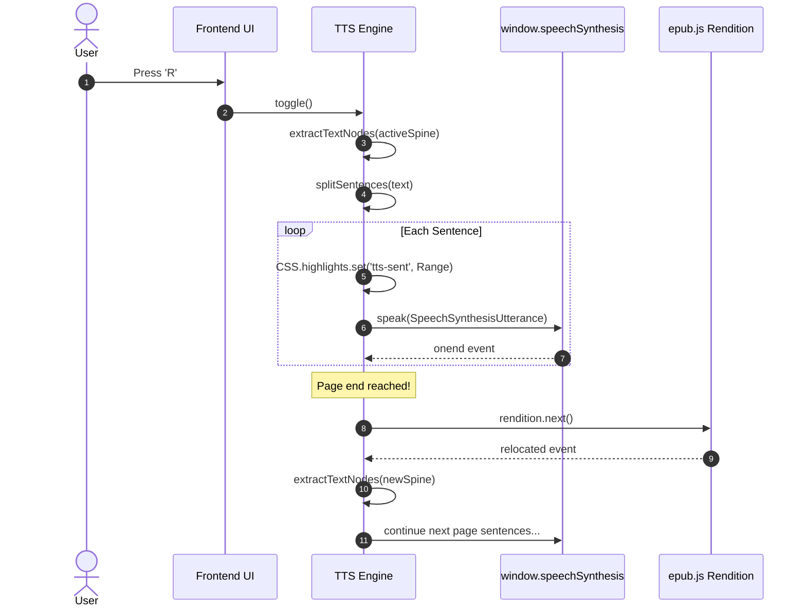

# Folio Reader — Comprehensive Design Document & Low-Level Design (LLD)

> **Audience:** Core developers, new contributors, and maintainers.  
> **Scope:** Architecture, subsystem low-level design, feature-to-code mapping, data schemas, sequence flows, and testing suite.  
> **Repository:** `ebook_reader_glm53flash` / `tauri_epub_reader`  
> **Last Updated:** 2026-11-10

---

## 1. Executive Summary & System Architecture

Folio Reader is an ultralight (~9 MB standalone executable), privacy-first, offline-native ebook reader for Windows (supporting **EPUB 2/3, MOBI, AZW, and AZW3**). It couples a native **Tauri 2.0 (Rust)** backend with **native Windows Edge WebView2**, completely eliminating the overhead of bundled Chromium browsers while delivering a 60 FPS, GPU-accelerated paper reading experience.

### 1.1 High-Level Architecture



### 1.2 Architectural Invariants & Non-Negotiables

1. **Zero-Copy / Binary IPC Discipline:** Ebook files are never serialized across the JSON bridge as numeric arrays. Unzipped EPUB and unpacked MOBI/AZW books are served through the native `folio-cache://` protocol scheme directly from disk; fallback opens use `tauri::ipc::Response` raw byte vectors.
2. **GPU-Composited Animation Guarantee:** The 3D paper fold and slide page turns write exclusively to `transform` (`translateX`, `rotateY`, `translateZ`), `opacity`, and `clip-path` CSS properties. Live text inside iframes is never subjected to matrix rotation during reading; pre-rasterized snapshot leaves are used instead.
3. **Never-Freeze Main Thread:** Heavy background jobs (CFI location generation and full-text search indexing) run in cooperative idle slices (`requestIdleCallback`, 2–6 spines/tick, paused when `document.hidden`).
4. **Complete Offline Autonomy:** Zero remote CDN dependencies. All reader scripts (`epub.min.js`, `jszip.min.js`), local fonts (Literata, Lexend, Atkinson Hyperlegible, OpenDyslexic), styling, and neural TTS runtimes are bundled locally.

---

## 2. Repository & File Manifest

### 2.1 File Map

| File Path | Type | Size / Lines | Primary Responsibilities |
|---|---|---|---|
| [`tauri_epub_reader/src-tauri/src/main.rs`](file:///f:/Siva_f/ebook_reader_glm53flash/tauri_epub_reader/src-tauri/src/main.rs) | Rust | 7 lines | Windows release subsystem declaration (`windows_subsystem = "windows"`), delegates to `app_lib::run()`. |
| [`tauri_epub_reader/src-tauri/src/lib.rs`](file:///f:/Siva_f/ebook_reader_glm53flash/tauri_epub_reader/src-tauri/src/lib.rs) | Rust | ~2,100 lines | Tauri commands, custom URI protocol `folio-cache://`, unzipper, zip-slip validator, LRU disk & memory caches, GPU flags, single-instance listener, and Rust unit tests (U1–U34). |
| [`tauri_epub_reader/src-tauri/src/mobi.rs`](file:///f:/Siva_f/ebook_reader_glm53flash/tauri_epub_reader/src-tauri/src/mobi.rs) | Rust | ~1,800 lines | MOBI / AZW / PalmDOC decompression subsystem, Palm Database parser, LZ77 decompressor, CP1252 transcoding, HTML sanitization, synthetic EPUB OEBPS packager, and MOBI security tests. |
| [`tauri_epub_reader/src-tauri/Cargo.toml`](file:///f:/Siva_f/ebook_reader_glm53flash/tauri_epub_reader/src-tauri/Cargo.toml) | TOML | 30 lines | Rust crate dependencies: `tauri 2.11`, `tauri-plugin-single-instance`, `rfd 0.17`, `zip 2`, `sha2 0.10`, `serde`, `serde_json`. |
| [`tauri_epub_reader/src-tauri/tauri.conf.json`](file:///f:/Siva_f/ebook_reader_glm53flash/tauri_epub_reader/src-tauri/tauri.conf.json) | JSON | 47 lines | Window configurations (1280x820, min 800x600), security CSP, app bundle icons, and `.epub`, `.mobi`, `.azw`, `.azw3` Windows file associations. |
| [`tauri_epub_reader/src-tauri/capabilities/default.json`](file:///f:/Siva_f/ebook_reader_glm53flash/tauri_epub_reader/src-tauri/capabilities/default.json) | JSON | 12 lines | Tauri 2 security capability ACL manifest assigning `core:default` permissions to the `main` window. |
| [`tauri_epub_reader/src-tauri/build.rs`](file:///f:/Siva_f/ebook_reader_glm53flash/tauri_epub_reader/src-tauri/build.rs) | Rust | 3 lines | Tauri build script invoking `tauri_build::build()`. |
| [`tauri_epub_reader/src/index.html`](file:///f:/Siva_f/ebook_reader_glm53flash/tauri_epub_reader/src/index.html) | HTML/CSS/JS | ~10,500 lines (~490 KB) | Complete frontend presentation, layout CSS, reading engine, 3D paper turn compositor, edge-hover chapter navigation, progress rail, ribbon, pill, dual TTS, search, annotations, and UI drawers. |
| [`tauri_epub_reader/src/vendor/jszip.min.js`](file:///f:/Siva_f/ebook_reader_glm53flash/tauri_epub_reader/src/vendor/jszip.min.js) | JS | 98 KB | Bundled local JSZip library for browser-mode unzipping and EPUB parsing. |
| [`tauri_epub_reader/src/vendor/epub.min.js`](file:///f:/Siva_f/ebook_reader_glm53flash/tauri_epub_reader/src/vendor/epub.min.js) | JS | 224 KB | Vendored epub.js 0.3 library providing EPUB spine navigation, Rendition, and CFI locations. |
| [`tauri_epub_reader/src/vendor/kitten/`](file:///f:/Siva_f/ebook_reader_glm53flash/tauri_epub_reader/src/vendor/kitten/) | JS/WASM | ~36 MB | KittenTTS offline neural voice engine (`kitten.bundle.js`, `ort-wasm-simd-threaded.wasm`, `ort-wasm-simd-threaded.jsep.wasm`, ONNX Runtime WebAssembly SIMD runtime). |
| [`tauri_epub_reader/src/vendor/fonts/`](file:///f:/Siva_f/ebook_reader_glm53flash/tauri_epub_reader/src/vendor/fonts/) | WOFF2 | 11 font files | Offline font assets: Literata, Lexend, Atkinson Hyperlegible, OpenDyslexic (400, 600, 700 weights). |
| [`tauri_epub_reader/package.json`](file:///f:/Siva_f/ebook_reader_glm53flash/tauri_epub_reader/package.json) | JSON | 30 lines | Project scripts (`dev`, `build`, `test`, `scan`, `lint`, `test:e2e`, `test:rust`), dependencies and devDependencies. |
| [`tauri_epub_reader/playwright.config.mjs`](file:///f:/Siva_f/ebook_reader_glm53flash/tauri_epub_reader/playwright.config.mjs) | JS | 32 lines | Playwright E2E configuration serving `src/` on port 8124, 1 worker, single-test isolation. |
| [`tauri_epub_reader/tests/scan-file-handling.mjs`](file:///f:/Siva_f/ebook_reader_glm53flash/tauri_epub_reader/tests/scan-file-handling.mjs) | JS | ~160 lines | 27 static invariant and security regression tests verifying IPC boundaries, CSP, entity handling, desk-dimming, and theme tokens. |
| [`tauri_epub_reader/tests/e2e/helpers.mjs`](file:///f:/Siva_f/ebook_reader_glm53flash/tauri_epub_reader/tests/e2e/helpers.mjs) | JS | 325 lines | Test utilities: `fresh()`, `openDemoReady()`, `viewerFrame()`, `SPEECH_MOCK`, in-memory synthetic EPUB builders (`buildTestEpub`, `generateStressBuffer`), pointer drag helpers (`slowDrag`, `fastFling`). |
| [`tauri_epub_reader/tests/e2e/shipped.spec.mjs`](file:///f:/Siva_f/ebook_reader_glm53flash/tauri_epub_reader/tests/e2e/shipped.spec.mjs) | JS | 312 lines | Regression specs R1–R16 verifying core reader features, wheel turning, rail scrub, TTS lifecycle, annotations, warmth, and drawers. |
| [`tauri_epub_reader/tests/e2e/design.spec.mjs`](file:///f:/Siva_f/ebook_reader_glm53flash/tauri_epub_reader/tests/e2e/design.spec.mjs) | JS | 571 lines | Design specs D1–D12 verifying contents pill, chapter ribbon, paper texture benchmark, full-spread two-phase fold, background slicing, index resume, and disk cache fallbacks. |
| [`tauri_epub_reader/docs/FEATURES.md`](file:///f:/Siva_f/ebook_reader_glm53flash/tauri_epub_reader/docs/FEATURES.md) | Markdown | 186 lines | High-level capabilities tracking, roadmap, and GPU budget summary. |
| [`tauri_epub_reader/docs/DESIGN-IMPROVEMENTS.md`](file:///f:/Siva_f/ebook_reader_glm53flash/tauri_epub_reader/docs/DESIGN-IMPROVEMENTS.md) | Markdown | 477 lines | Architectural specifications for disk cache (P-A), idle work slicing (P-B), contents pill (A-A), chapter ribbon (A-B), paper flip (A-C), and full-spread flip (A-S). |

---

## 3. Subsystem Low-Level Design (LLD) & Feature-to-Code Mapping

---

### Subsystem 1: Desktop Shell & Rust Backend

#### 1.1 Command-Line Arguments & File Association Launch
* **Functionality:** Double-clicking an `.epub` file in Windows Explorer launches the app and immediately displays the book. Passing a file path via the CLI opens it directly.
* **Code Location:**
  * Rust: [`tauri_epub_reader/src-tauri/src/lib.rs`](file:///f:/Siva_f/ebook_reader_glm53flash/tauri_epub_reader/src-tauri/src/lib.rs#L10-L24) — `get_initial_file()`, `first_epub_arg()`.
  * Config: [`tauri_epub_reader/src-tauri/tauri.conf.json`](file:///f:/Siva_f/ebook_reader_glm53flash/tauri_epub_reader/src-tauri/tauri.conf.json#L37-L44) — `bundle.fileAssociations` maps extension `epub`.
  * Frontend: [`tauri_epub_reader/src/index.html`](file:///f:/Siva_f/ebook_reader_glm53flash/tauri_epub_reader/src/index.html#L5768-L5773) — Startup hook calls `invoke('get_initial_file')` and triggers `tauriOpenPath(p)`.
* **Execution Flow:**
  ```
  Explorer -> app.exe "C:\Books\Dune.epub" -> first_epub_arg(std::env::args())
  Frontend mounted -> invoke('get_initial_file') -> tauriOpenPath(path)
  ```

#### 1.2 Single Instance & Cross-Process Forwarding
* **Functionality:** If the app is already open and a user double-clicks another `.epub`, a second instance does not spawn. Instead, the running window is unminimized, brought to focus, and instructed to open the newly requested book.
* **Code Location:**
  * Rust: [`tauri_epub_reader/src-tauri/src/lib.rs`](file:///f:/Siva_f/ebook_reader_glm53flash/tauri_epub_reader/src-tauri/src/lib.rs#L506-L517).
  * Frontend: [`tauri_epub_reader/src/index.html`](file:///f:/Siva_f/ebook_reader_glm53flash/tauri_epub_reader/src/index.html#L5768) — `window.__folioOpenPath = tauriOpenPath;`.
* **Details:** The `tauri-plugin-single-instance` catches the second process invocation, extracts the `.epub` argument via `first_epub_arg(args)`, focuses `win.set_focus()`, and evals `window.__folioOpenPath(<path>)`.

#### 1.3 Native File Dialog
* **Functionality:** Users can press `Ctrl + O` or click "Open book" to open a native Windows File Explorer dialog filtered to `*.epub`.
* **Code Location:**
  * Rust: [`tauri_epub_reader/src-tauri/src/lib.rs`](file:///f:/Siva_f/ebook_reader_glm53flash/tauri_epub_reader/src-tauri/src/lib.rs#L114-L120) — `pick_file()` via `rfd::FileDialog`.
  * Frontend: [`tauri_epub_reader/src/index.html`](file:///f:/Siva_f/ebook_reader_glm53flash/tauri_epub_reader/src/index.html#L5744-L5766).

#### 1.4 Unzipped Disk Cache (`book_open`) & Custom Protocol (`folio-cache://`)
* **Functionality:** Bypasses JSZip heap inflation on repeated opens. Books are decompressed once into `{app_cache_dir}/folio-unzip/{hash}/`. Subsequent opens serve files directly to `epub.js` via the `folio-cache://` protocol with accurate MIME types.
* **Code Location:**
  * Rust: [`tauri_epub_reader/src-tauri/src/lib.rs`](file:///f:/Siva_f/ebook_reader_glm53flash/tauri_epub_reader/src-tauri/src/lib.rs#L122-L359, #L435-L501).
    * `compute_book_key()`: Key derived from `sha256(path) + file_length + mtime_ms`.
    * `sanitize_entry()`: Path traversal / Zip-Slip protection.
    * `unzip_epub()`: Extracts archive using `zip` crate; writes `manifest.json` and `atime`.
    * `evict_disk_cache()`: Background thread evicts least recently opened directories exceeding 600 MB or 30 books.
    * Protocol handler: `register_uri_scheme_protocol("folio-cache", ...)`.
  * Frontend: [`tauri_epub_reader/src/index.html`](file:///f:/Siva_f/ebook_reader_glm53flash/tauri_epub_reader/src/index.html#L5681-L5708) — `openEpubPath()`, `tauriOpenPath()`.

#### 1.5 In-Memory LRU Cache & Raw Binary IPC
* **Functionality:** When disk unzipping is bypassed or fails, `read_file_bytes()` returns raw bytes using `tauri::ipc::Response`, backed by a 4-book / 160 MB in-memory LRU (`BookCache`).
* **Code Location:**
  * Rust: [`tauri_epub_reader/src-tauri/src/lib.rs`](file:///f:/Siva_f/ebook_reader_glm53flash/tauri_epub_reader/src-tauri/src/lib.rs#L30-L112).

#### 1.6 GPU Rasterization Flag Injection
* **Functionality:** Forces Edge WebView2 to hardware-rasterize 2D graphics and keep textures zero-copy on the GPU.
* **Code Location:**
  * Rust: [`tauri_epub_reader/src-tauri/src/lib.rs`](file:///f:/Siva_f/ebook_reader_glm53flash/tauri_epub_reader/src-tauri/src/lib.rs#L407-L433) — `merge_gpu_flags()`.
  * Environment variable: `WEBVIEW2_ADDITIONAL_BROWSER_ARGUMENTS = "--enable-gpu-rasterization --enable-zero-copy --ignore-gpu-blocklist"`.

#### 1.7 MOBI / AZW / PalmDOC Decompression Subsystem (`src-tauri/src/mobi.rs`)
* **Functionality:** Converts DRM-free Mobipocket (MOBI 6/7) and Kindle Format 8 (KF8 / AZW3) ebooks into standards-compliant synthetic OEBPS packages directly on disk, served transparently to `epub.js` via `folio-cache://`.
* **Architecture & Decoding Pipeline:**
  1. **Palm Database (PDB) Parser (`PalmDatabase`):** Validates the 78-byte header, database name, version, and record offsets list.
  2. **PalmDOC & MOBI Headers:** Record 0 is parsed into `PalmDocHeader` (compression method, record length, record count, encryption) and `MobiHeader` (MOBI magic, encoding, EXTH flags, title offsets, KF8 boundary).
  3. **Metadata Extraction (`parse_exth_and_metadata`):** Parses EXTH records for author (100), publisher (101), description (103), ISBN (104), cover offset (201), updated title (503), and language (524).
  4. **PalmDOC LZ77 Decompressor (`decompress_palmdoc_capped`):** Decompresses text runs with memory budget capping (`max_out`) to prevent multi-GB allocation bombs. Processes literals (0x01..0x08), plain ASCII (0x09..0x7F), 2-byte distance/length backreferences (0x80..0xBF) with strict out-of-bounds guards, and space-prefixed chars (0xC0..0xFF).
  5. **Trailing Entry Stripping (`strip_trailing_entries`):** Strips variable-length multibyte flags from compressed record tails.
  6. **Encoding Transcoding (`cp1252_to_utf8`):** Transcodes legacy Windows-1252 encoded books to valid UTF-8.
  7. **HTML Sanitization & Cross-Chapter Links:**
     - `clean_chapter_body()` and `sanitize_html_tag()` strip dangerous elements (`<script>`, `<iframe>`), neutralize unsafe event handlers (`onload`, `onclick`, `javascript:` URIs), and prevent XSS injection.
     - Rewrites Mobipocket `filepos:XXXXXXXXXX` internal links and anchors into standard EPUB cross-chapter fragment anchors.
     - Rewrites `recindex:XXXX` image references to relative synthetic URLs (`images/img_XXXX.ext`).
  8. **Synthetic OEBPS Package Assembly (`unpack_mobi`):**
     - Emits `META-INF/container.xml` pointing to `content.opf`.
     - Emits `content.opf` with complete metadata, manifest, spine items, and guide.
     - Emits `toc.ncx` for hierarchical navigation.
     - Slices decompressed HTML into chapters (`ch_0001.xhtml`, `ch_0002.xhtml`, ...).
     - Extracts and writes image resources (`images/img_XXXX.ext`).
     - Emits `manifest.json` for Folio's cache protocol.
* **Code Location:** [`tauri_epub_reader/src-tauri/src/mobi.rs`](file:///f:/Siva_f/ebook_reader_glm53flash/tauri_epub_reader/src-tauri/src/mobi.rs).

---

### Subsystem 2: Book Ingestion & State Initialization



* **Code Location:**
  * `ensureEpubUrlPatched()`: [`tauri_epub_reader/src/index.html`](file:///f:/Siva_f/ebook_reader_glm53flash/tauri_epub_reader/src/index.html#L1650-L1688).
  * `openBuffer()`: [`tauri_epub_reader/src/index.html`](file:///f:/Siva_f/ebook_reader_glm53flash/tauri_epub_reader/src/index.html#L1690-L1795).
  * `createRendition()`: [`tauri_epub_reader/src/index.html`](file:///f:/Siva_f/ebook_reader_glm53flash/tauri_epub_reader/src/index.html#L1621-L1648).
  * `BookStorage`: [`tauri_epub_reader/src/index.html`](file:///f:/Siva_f/ebook_reader_glm53flash/tauri_epub_reader/src/index.html#L1281-L1465) (IndexedDB storage for browser-only fallbacks).

---

### Subsystem 3: Reading Engine & Typographic Harmony

#### 3.1 Typographic Harmony Engine
* **Functionality:** Dynamically computes optimal reading ergonomics based on Characters Per Line (CPL). Calculates line-height, letter-spacing, and word-spacing continuously as the user resizes the window or adjusts font size.
* **Code Location:** [`tauri_epub_reader/src/index.html`](file:///f:/Siva_f/ebook_reader_glm53flash/tauri_epub_reader/src/index.html#L1000-L1070)
  * `calcCPL()`: Computes average line length in characters (`effectiveWidth / (fontSize * fontAvgCharWidth)`).
  * `calcTypographicHarmony()`: Applies Bringhurst typographic rules to adjust line height (1.35–1.75), letter spacing (-0.02em to +0.03em), and word spacing.
  * Presets: `PRESETS.classic`, `PRESETS.relaxed`, `PRESETS.focus`, `PRESETS.auto` ([`index.html:973`](file:///f:/Siva_f/ebook_reader_glm53flash/tauri_epub_reader/src/index.html#L973)).

#### 3.2 Dynamic Layout, Spread & Auto-Fit
* **Functionality:** Seamlessly alternates between single-page view and two-page spread. In `auto` mode, automatically converts to dual-spread when viewport width exceeds 960 px.
* **Code Location:** [`tauri_epub_reader/src/index.html`](file:///f:/Siva_f/ebook_reader_glm53flash/tauri_epub_reader/src/index.html#L1072-L1120, #L1614-L1620)
  * `effectiveSpread()`: Evaluates `settings.spread` (`auto`, `spread`, `single`).
  * `applyFit()`: Calculates CSS column widths and writes inline styles to `#viewer`.

#### 3.3 Typography Memory & Bionic Reading
* **Functionality:**
  * **Per-Book Typography:** Persists custom font family, size, line-height, and margins keyed by book title (`folio-typo:<title>`).
  * **Bionic Reading:** Automatically parses chapter DOM text nodes and wraps the first 40–50% of each word in `<b>` tags to guide rapid eye fixation.
* **Code Location:**
  * Typography Memory: [`tauri_epub_reader/src/index.html`](file:///f:/Siva_f/ebook_reader_glm53flash/tauri_epub_reader/src/index.html#L903-L912) — `loadPerBookType()`.
  * Bionic Engine: [`tauri_epub_reader/src/index.html`](file:///f:/Siva_f/ebook_reader_glm53flash/tauri_epub_reader/src/index.html#L1958-L2015) — `bionifyDoc()`, `debionify()`, `setBionic()`.

---

### Subsystem 4: Page-Turn Graphics Pipeline & 3D Physics


#### 4.1 PageTurnCompositor & Full-Spread Two-Phase Fold
* **Functionality:** Generates realistic paper fold effects. In dual-page spread mode, the fold sweeps **across the entire spread**:
  * **Phase 1 ($p < 0.5$):** Turning leaf lifts from the outer margin; remaining un-turned page is clipped via `clip-path: inset(0 R 0 0)`.
  * **Phase 2 ($p \ge 0.5$):** The back of the turning page (`.pt-back-sheet`) travels across the spine, physically overlapping and dimming the opposite page.
  * **GPU Invariant:** Live text is never rotated in 3D. Transformations are applied to pre-rasterized snapshot nodes using hardware-accelerated CSS properties only.
* **Code Location:** [`tauri_epub_reader/src/index.html`](file:///f:/Siva_f/ebook_reader_glm53flash/tauri_epub_reader/src/index.html#L3682-L4085)
  * `init()`: Constructs compositor DOM hierarchy (`.pt-sheet`, `.pt-back-sheet`, `.pt-fold-shadow`, `.pt-curl-highlight`, `.pt-spine-valley`).
  * `render(p)`: Evaluates phase geometry, updates `clip-path`, scales fold shadows, and adjusts spine valley opacity (`index.html:3810-3940`).

#### 4.2 Paper-Grade Aesthetics: Grain Tile & Settle Audio
* **Functionality:**
  * **GrainTile:** Generates a 256×256 procedural noise texture canvas once at startup and applies it as a `multiply` blend layer without per-frame repaints.
  * **PageSound:** Synthesizes realistic paper friction audio using Web Audio API buffer nodes, including a secondary noise burst when passing the fold midpoint ($p = 0.5$).
* **Code Location:**
  * GrainTile: [`tauri_epub_reader/src/index.html`](file:///f:/Siva_f/ebook_reader_glm53flash/tauri_epub_reader/src/index.html#L4742-L4766).
  * PageSound: [`tauri_epub_reader/src/index.html`](file:///f:/Siva_f/ebook_reader_glm53flash/tauri_epub_reader/src/index.html#L4698-L4740).

#### 4.3 Damped-Spring Physics & Gesture Controller
* **Functionality:** Tracks touch and mouse drag gestures. Drops use a damped spring model ($\omega=24.0, \zeta=0.88$). Flings commit with low displacement if drag velocity exceeds threshold.
* **Code Location:**
  * Physics: [`tauri_epub_reader/src/index.html`](file:///f:/Siva_f/ebook_reader_glm53flash/tauri_epub_reader/src/index.html#L4087-L4124) — `PageTurnPhysics`.
  * Gesture Controller: [`tauri_epub_reader/src/index.html`](file:///f:/Siva_f/ebook_reader_glm53flash/tauri_epub_reader/src/index.html#L4125-L4374) — `TurnGestureController`.

---

### Subsystem 5: Navigation, Locations & Progress

#### 5.1 Global Book-Wide Paging Engine (`LocEngine`)
* **Functionality:** Computes true book-wide page counts ("Page 142 of 580") by dividing text into 1000-character CFI increments. Runs in cooperative idle slices and stores results per book in `localStorage['folio-locs:<title>']`.
* **Code Location:** [`tauri_epub_reader/src/index.html`](file:///f:/Siva_f/ebook_reader_glm53flash/tauri_epub_reader/src/index.html#L2090-L2210)
  * `ensure()`: Generates locations during idle windows (`BgJobs.run`).
  * `forCfi(cfi)`: Binary searches generated CFI array to find the exact global page index.
  * `refreshUI()`: Updates `#pageBadge` and informs the chapter ribbon.

#### 5.2 Hairline Chapter Progress Ribbon (`Ribbon`)
* **Functionality:** A 3 px top-edge structural map of the book. Each chapter is represented by a segment whose `flex-grow` is weighted by its CFI location count. An accent playhead tracks global reading progress. Clicking any segment jumps directly to that chapter. Dims to 45% when chrome auto-hides.
* **Code Location:** [`tauri_epub_reader/src/index.html`](file:///f:/Siva_f/ebook_reader_glm53flash/tauri_epub_reader/src/index.html#L2403-L2504)
  * `build()`: Creates segmented bar capped at 240 elements.
  * `rebuild()`: Re-proportions segments once `LocEngine` completes.
  * `move(frac)`: Smoothly transitions the playhead indicator.

#### 5.3 Top-Left Contents Pill (`#posPill`) & Closed-Drawer Isolation
* **Functionality:** Positioned in `#topbar`, displaying the truncated current chapter title and progress percent (e.g. "Chapter IV · 34%"). Clicking opens the Contents drawer.
* **Chrome Cleanliness Invariant:** Closed drawers (`#toc`, `#searchDrawer`, `#sheet`, `#helpOverlay`) enforce `visibility: hidden` in CSS, preventing transparent close buttons from capturing mouse hits at the top-left corner.
* **Code Location:**
  * Markup: [`tauri_epub_reader/src/index.html`](file:///f:/Siva_f/ebook_reader_glm53flash/tauri_epub_reader/src/index.html#L585-L589).
  * Logic: [`tauri_epub_reader/src/index.html`](file:///f:/Siva_f/ebook_reader_glm53flash/tauri_epub_reader/src/index.html#L2260-L2280) (updated inside `onRelocated()`).
  * Styles: [`tauri_epub_reader/src/index.html`](file:///f:/Siva_f/ebook_reader_glm53flash/tauri_epub_reader/src/index.html#L105-L135, #L320-L335).

#### 5.4 Progress Rail Scrubbing
* **Functionality:** Draggable scrub bar at the viewport bottom providing fine-grained page-by-page jumping via `LocEngine.cfiForFraction(f)`.
* **Code Location:** [`tauri_epub_reader/src/index.html`](file:///f:/Siva_f/ebook_reader_glm53flash/tauri_epub_reader/src/index.html#L5417-L5462) — `railSeek()`, `railFraction()`.

---

### Subsystem 6: Search & Lookup Engine

#### 6.1 Chunked Idle Search Indexer (`SearchIndex`)
* **Functionality:** Extracts and indexes chapter text in the background without causing frame drops.
  * **Slicing:** Processes 1–6 spines per tick depending on `deadline.timeRemaining()`.
  * **Persistence & Resume:** Saves progress in IndexedDB (`searchIndex` store). If interrupted or reloaded, resumes exactly where it left off.
  * **Visibility Pause:** Pauses indexing immediately when the app window is hidden or minimized (`document.hidden == true`).
* **Code Location:** [`tauri_epub_reader/src/index.html`](file:///f:/Siva_f/ebook_reader_glm53flash/tauri_epub_reader/src/index.html#L2980-L3180)
  * `_build()`: Main slice loop.
  * `prepare()`: Cache check and resume dispatcher.
  * `query(q)`: Regex match engine with context snippet generation.

#### 6.2 Offline Dictionary Cache (`DictCache`)
* **Functionality:** When a word is selected, "Define" looks up definitions from `api.dictionaryapi.dev` and caches results in `localStorage['folio-dict:<word>']` for offline reuse.
* **Code Location:** [`tauri_epub_reader/src/index.html`](file:///f:/Siva_f/ebook_reader_glm53flash/tauri_epub_reader/src/index.html#L4809-L4817).

---

### Subsystem 7: Annotations, Audio & Reading Polish

#### 7.1 Highlights & Note Editor (`Highlights`)
* **Functionality:** Select text to highlight in yellow, green, blue, or pink. Clicking an existing highlight opens an editor popup (`#hlPop`) to add notes, change colors, or delete the annotation. Highlights are listed in the TOC drawer's "Highlights" tab.
* **Code Location:** [`tauri_epub_reader/src/index.html`](file:///f:/Siva_f/ebook_reader_glm53flash/tauri_epub_reader/src/index.html#L2800-L2955)
  * `add()`, `update()`, `remove()`.
  * `openPop(id, pos)`: Floating popup positioning within viewport bounds.
  * `renderDrawer()`: Renders snippet list with click-to-jump.

#### 7.2 Read-Aloud TTS & KittenTTS Neural Speech Subsystem (`TTS` & `KittenRunner`)
* **Functionality:** High-fidelity, offline-first text-to-speech reading with dual-engine architecture:
  1. **System Voices (`window.speechSynthesis`):** Standard OS-provided speech synthesis with selectable system voices.
  2. **KittenTTS Neural Voices (`src/vendor/kitten/`):** Local neural voice synthesis running a quantized StyleTTS-2 architecture (`KittenML/kitten-tts-mini-0.8`, ~92 MB) completely offline within the WebView runtime.
* **Neural Subsystem Architecture (`KittenRunner`):**
  - **Runtime & Bundles:** Powered by local Transformers.js and ONNX Runtime WebAssembly SIMD (`kitten.bundle.js`, `ort-wasm-simd-threaded.wasm`, `ort-wasm-simd-threaded.jsep.wasm`).
  - **On-Demand Local Cache:** Model weights install once via a 1-click in-app installer with live download progress reporting, persisting in WebView cache for permanent offline use.
  - **Voices Supported:** High-quality expressive presets including `Bella`, `Jasper`, `Leo`, and other neural personas.
  - **Audio Pipeline:** Model outputs Float32 mono 24 kHz audio samples -> transcoded to PCM16 RIFF WAVE bytes via `float32ToWav()` -> decoded and scheduled via Web Audio API (`AudioContext`, `AudioBufferSourceNode`).
* **Reading Synchrony & Highlighting:**
  - **CSS Custom Highlight API:** Uses `::highlight(tts-sent)` to paint real-time sentence highlights across the active spine without modifying iframe DOM nodes or provoking layout reflows.
  - **Continuous Auto-Advance:** When the final sentence of a page finishes playing, triggers `rendition.next()` and smoothly resumes playback on the incoming page.
  - **Keyboard Controls:** `R` (play / pause), `Shift + R` (stop), `-` / `=` (speed decrement / increment).
* **Code Location:**
  - Frontend: [`tauri_epub_reader/src/index.html`](file:///f:/Siva_f/ebook_reader_glm53flash/tauri_epub_reader/src/index.html) — `TTS` and `KittenRunner`.
  - Neural Runtimes: [`tauri_epub_reader/src/vendor/kitten/`](file:///f:/Siva_f/ebook_reader_glm53flash/tauri_epub_reader/src/vendor/kitten/).

#### 7.3 Reading Polish Pack: Footnotes, Lightbox, AutoScroll & Warmth
* **Footnotes (`Footnotes`):** Catches clicks on EPUB `noteref` links and displays footnote text in an inline popup without losing reading place ([`index.html:4780-4808`](file:///f:/Siva_f/ebook_reader_glm53flash/tauri_epub_reader/src/index.html#L4780-L4808)).
* **Image Lightbox (`Lightbox`):** Clicking any image inside a chapter displays a full-viewport zoom overlay; dismissed with `Esc` ([`index.html:4768-4779`](file:///f:/Siva_f/ebook_reader_glm53flash/tauri_epub_reader/src/index.html#L4768-L4779)).
* **Auto-Scroll (`AutoScroll`):** Middle-click initiates autoscroll mode. Pointer distance from the center origin dynamically drives page advance speed ([`index.html:5501-5531`](file:///f:/Siva_f/ebook_reader_glm53flash/tauri_epub_reader/src/index.html#L5501-L5531)).
* **Warmth Filter:** Adjustable night-mode blue-light filter (`#warm` element with amber overlay) ([`index.html:913-927`](file:///f:/Siva_f/ebook_reader_glm53flash/tauri_epub_reader/src/index.html#L913-L927)).

---

### Subsystem 8: Chrome, Input & Accessibility

#### 8.1 Auto-Hiding Chrome
* **Functionality:** Top and bottom navigation bars slide out of view after 3.4 seconds of inactivity. Hovering near the top 64 px or bottom 76 px reveals the chrome instantly.
* **Code Location:** [`tauri_epub_reader/src/index.html`](file:///f:/Siva_f/ebook_reader_glm53flash/tauri_epub_reader/src/index.html#L4818-L4860).

#### 8.2 Keyboard & Mouse Shortcut Bindings

| Shortcut | Action | Handler Function / Code Location |
|---|---|---|
| `Left` / `Right` / `Space` | Turn previous / next page | `onKey()` ([`index.html:4950`](file:///f:/Siva_f/ebook_reader_glm53flash/tauri_epub_reader/src/index.html#L4950)) |
| `Ctrl + O` | Open native file picker (EPUB, MOBI, AZW, AZW3) | `onKey()` calls `openFileViaTauri()` |
| `D` | Toggle dual spread vs single page | `onKey()` toggles `settings.spread` |
| `T` | Toggle Table of Contents drawer | `toggleToc()` ([`index.html:4862`](file:///f:/Siva_f/ebook_reader_glm53flash/tauri_epub_reader/src/index.html#L4862)) |
| `S` | Toggle Appearance & Typography sheet | `toggleSheet()` ([`index.html:4861`](file:///f:/Siva_f/ebook_reader_glm53flash/tauri_epub_reader/src/index.html#L4861)) |
| `Ctrl + F` | Toggle Search drawer | `toggleSearch()` ([`index.html:2972`](file:///f:/Siva_f/ebook_reader_glm53flash/tauri_epub_reader/src/index.html#L2972)) |
| `B` | Toggle bookmark on current page | `onKey()` calls `toggleBookmark()` |
| `R` | Play / Pause TTS read-aloud | `TTS.toggle()` ([`index.html:4520`](file:///f:/Siva_f/ebook_reader_glm53flash/tauri_epub_reader/src/index.html#L4520)) |
| `Shift + R` | Stop TTS read-aloud | `TTS.stop()` ([`index.html:4550`](file:///f:/Siva_f/ebook_reader_glm53flash/tauri_epub_reader/src/index.html#L4550)) |
| `-` / `=` | Decrease / Increase TTS rate | `TTS.setRateDelta()` |
| `[` / `]` | Previous / Next chapter | `onKey()` calls `prevChapter()` / `nextChapter()` |
| `G` | Toggle reading guide line (ruler) | `setGuide()` ([`index.html:4476`](file:///f:/Siva_f/ebook_reader_glm53flash/tauri_epub_reader/src/index.html#L4476)) |
| `F` | Toggle fullscreen mode | `toggleFullscreen()` ([`index.html:4907`](file:///f:/Siva_f/ebook_reader_glm53flash/tauri_epub_reader/src/index.html#L4907)) |
| `?` | Toggle keyboard shortcuts modal | `toggleHelp()` ([`index.html:4873`](file:///f:/Siva_f/ebook_reader_glm53flash/tauri_epub_reader/src/index.html#L4873)) |
| `Esc` | Close all drawers, search, and dialogs | `closePanels()` ([`index.html:4863`](file:///f:/Siva_f/ebook_reader_glm53flash/tauri_epub_reader/src/index.html#L4863)) |
| `Wheel Up / Down` | Turn page backward / forward | `onWheel()` ([`index.html:5479`](file:///f:/Siva_f/ebook_reader_glm53flash/tauri_epub_reader/src/index.html#L5479)) |
| `Ctrl + Wheel` | Increase / Decrease font size | `onWheel()` calls `nudgeSize()` |
| `Alt + Wheel` | Increase / Decrease page width | `onWheel()` calls `nudgeWidth()` |
| `Middle Click` | Toggle autoscroll mode | `onDocPointerDown()` ([`index.html:5532`](file:///f:/Siva_f/ebook_reader_glm53flash/tauri_epub_reader/src/index.html#L5532)) |

---

## 4. Data Models, Schemas & Persistence

### 4.1 Rust Data Structures (`src-tauri/src/lib.rs`)

```rust
// Manifest of unzipped EPUB assets stored in manifest.json
#[derive(Serialize, Deserialize, Debug, Clone, PartialEq)]
pub struct ManifestFile {
    pub zip_path: String, // e.g. "OEBPS/ch1.xhtml"
    pub size: u64,
}

#[derive(Serialize, Deserialize, Debug, Clone, PartialEq)]
pub struct BookManifest {
    pub path: String,          // Original filesystem path
    pub len: u64,             // File length in bytes
    pub mtime_ms: u128,       // Last modified timestamp in ms
    pub files: Vec<ManifestFile>,
}

#[derive(Serialize, Deserialize, Debug, Clone)]
pub struct BookHandle {
    pub hash: String,          // Unique cache key (sha256 prefix + len + mtime)
    pub cache_dir: String,     // Absolute path on disk
    pub manifest: BookManifest,
}
```

### 4.2 LocalStorage Schema

| Key Pattern | Format | Description |
|---|---|---|
| `folio-settings` | JSON Object | Global user preferences: `{ font, size, theme, spread, turnFx, warmth, sound, grain, perBookType, ... }`. |
| `folio-locs:<Title>` | JSON Object | Persisted CFI location arrays from `LocEngine`: `{ title, total, locations: [cfi, ...] }`. |
| `folio-typo:<Title>` | JSON Object | Per-book typography settings overrides: `{ font, size, lineHeight, letter, word, margin, ... }`. |
| `folio-pos:<Title>` | String (CFI) | Last read position CFI for auto-resume. |
| `folio-highlights` | JSON Array | Array of highlights: `[{ id, cfi, color, note, text, time, bookTitle }]`. |
| `folio-bookmarks` | JSON Array | Array of bookmarks: `[{ id, cfi, title, label, time }]`. |
| `folio-recents` | JSON Array | Recent books list: `[{ title, author, pct, cfi, filePath, coverThumb }]`. |
| `folio-dict:<word>` | String | Cached definition text for offline dictionary lookups. |
| `folio-stats` | JSON Object | Reading activity: `{ minutesByDay: { [date]: mins }, pagesByDay: { [date]: count } }`. |

### 4.3 IndexedDB Schema (`folio-storage` Database)

* **Object Store: `books`**
  * Key: `title` (string).
  * Value: `{ title, author, buffer, filePath, cfi, date }` (used for browser fallback mode).
* **Object Store: `searchIndex`**
  * Key: `title` (string).
  * Value: `{ title, done, total, partial: boolean, chapters: [{ href, title, text }] }`.

---

## 5. End-to-End Sequence Workflows

### 5.1 Page Turn Workflow (Gesture -> Spring -> GPU Flip -> Relocation)



### 5.2 Text-to-Speech (TTS) Continuous Read-Aloud Workflow



---

## 6. Automated Test Suite & Verification Matrix

The project has comprehensive automated coverage across both backend and frontend, executable with a single command:
```powershell
npm test
```

### 6.1 Rust Backend Unit Tests (U1–U34, `src-tauri/src/lib.rs`)

* **Execution:** `npm run test:rust` or `cargo test` in `src-tauri`

| Spec ID | Test Function | Target Feature | Validation Criteria |
|---|---|---|---|
| **U1** | `test_u1_book_cache_key` | In-memory cache key validity | Same length + mtime returns cache hit; file modification invalidates entry. |
| **U2** | `test_u2_book_cache_lru` | Memory LRU eviction | Exceeding 4 entries evicts the least recently accessed book. |
| **U3** | `test_u3_zip_slip` | Zip-Slip security validator | Rejects `../`, absolute paths (`/abs`), and Windows drive paths (`C:/`). Normal paths pass. |
| **U4** | `test_u4_manifest` | Manifest serialization | Manifest JSON roundtrips correctly; metadata changes trigger re-unzip. |
| **U5** | `test_u5_gpu_flags_merge` | GPU flag injection | Appends missing hardware acceleration flags without duplicating existing ones. |
| **U6** | `test_u6_fix_entities_named_and_bare_ampersand` | XML entity repair | Encodes bare ampersands while preserving named HTML/XML entities. |
| **U7** | `test_u7_fix_entities_cdata_and_structure` | Entity structural safety | Protects CDATA sections, comments, and XML tags during entity repair. |
| **U8** | `test_u8_percent_decode` | URI decoding | Correctly decodes percent-encoded UTF-8 characters and spaces. |
| **U9** | `test_u9_is_valid_cache_hash` | Hash format validation | Enforces strict 64-character lowercase hexadecimal hash strings. |
| **U10** | `test_u10_is_xml_mime` | MIME type detection | Accurately identifies XHTML, XML, OPF, and NCX content types. |
| **U11** | `test_u11_evict_disk_cache_protect` | Disk cache eviction | Evicts stale book folders when total disk usage exceeds 600 MB or 30 books. |
| **U12** | `test_u12_response_body_repairs_utf8_and_preserves_legacy_bytes` | Protocol response encoding | Repairs UTF-8 XML payloads and delivers binary assets unchanged. |
| **U13** | `test_u13_unzip_epub_roundtrip_and_guards` | Archive extraction & safety | Round-trips valid EPUB archives; rejects malformed archives. |
| **U14** | `test_u14_evict_counts_protected_bytes` | Active cache protection | Ensures active book cache is protected and counted during eviction. |
| **U15** | `test_u15_first_epub_arg` | CLI argument parser | Extracts first `.epub`, `.mobi`, `.azw`, or `.azw3` path from command line arguments. |
| **U16** | `test_u16_percent_encoded_traversal_never_sanitizes` | Traversal attack defense | Rejects percent-encoded directory traversal sequences (`%2e%2e%2f`). |
| **U17** | `test_u17_unzip_rejects_entry_count_bomb` | ZIP bomb defense | Rejects archives exceeding safe entry count limits (>10,000 files). |
| **U18** | `test_u18_cache_uri_hash_extraction` | Protocol URI parsing | Extracts valid book hash and asset path from `folio-cache://` requests. |
| **U19** | `test_u19_book_cache_oversized_and_byte_budget` | Memory budget enforcement | Rejects or bypasses cache for oversized buffers exceeding byte budget. |
| **U20** | `test_u20_book_cache_concurrent_no_deadlock` | Multi-threaded concurrency | Verifies thread safety and absence of deadlocks under parallel access. |
| **U21** | `test_u21_unzip_malformed_archive` | Malformed archive handling | Gracefully returns error on corrupt archives without crashing. |
| **U22** | `test_u22_percent_decode_and_custom_protocol_paths` | Path normalization | Validates complex percent-encoded custom protocol asset paths. |
| **U23** | `test_u23_palmdoc_lz77_decompression` | PalmDOC LZ77 decompressor | Validates literal runs, backreferences, and space-prefix decompression. |
| **U24** | `test_u24_trailing_bytes_and_cp1252` | Trailing byte & encoding | Strips variable-length trailing entries and transcodes Windows-1252 to UTF-8. |
| **U25** | `test_u25_mobi_unpack_roundtrip` | MOBI/AZW unpack pipeline | Full synthetic EPUB OEBPS generation from synthetic MOBI input. |
| **U26** | `test_u26_mobi_drm_protection_detected` | DRM detection & guard | Detects encrypted/DRM-locked MOBI files and aborts cleanly. |
| **U27** | `test_u27_validate_book_path_security` | Filesystem path security | Rejects path traversal and invalid device paths across Windows platforms. |
| **U28** | `test_u28_sanitize_entry_windows_devices_and_streams` | Windows device protection | Rejects reserved DOS device names (CON, PRN, AUX, NUL) and alternate data streams (`:`). |
| **U29** | `test_u29_mobi_html_sanitization` | HTML sanitization | Strips scripts, event handlers, and malicious tags from decompressed chapters. |
| **U30** | `test_u30_mobi_non_ascii_no_panic` | Non-ASCII resilience | Ensures multi-byte UTF-8 and binary slices never cause panic or out-of-bounds indexing. |
| **U31** | `test_u31_palmdoc_decompression_budget` | LZ77 budget capping | Defeats decompression bombs by enforcing strict output byte budgets. |
| **U32** | `test_u32_mobi_palmdoc_unpack` | Real-world PalmDOC unpack | Unpacks and structures PalmDOC records into valid readable XHTML spine chapters. |
| **U33** | `test_u33_active_book_hash_protection_in_eviction` | Active hash protection | Protects currently loaded book hash from background disk eviction. |
| **U34** | `test_u34_active_reading_hash_protection_in_eviction` | Reading state eviction lock | Prevents deletion of cache directories actively rendered by the frontend. |

### 6.2 MOBI Security & Parser Regression Matrix (`src-tauri/src/mobi.rs`)

* **Execution:** Executed as part of `cargo test` (42 tests total)

| Test Name | Focus Area | Validation Criteria |
|---|---|---|
| `test_fix1_sanitize_html_tag_no_infinite_loop` | Infinite loop defense | Malformed tags with nested unclosed brackets terminate cleanly. |
| `test_fix2_sanitize_html_tag_xss_bypass` | XSS attribute bypass | Rejects obfuscated event handlers without whitespace separation (``). |
| `test_fix3_rewrite_img_tag_safe_slice` | Byte slice safety | Safely slices multi-byte UTF-8 image tags without splitting code points. |
| `test_fix4_filepos_anchors_and_cross_chapter_links` | Cross-chapter anchors | Converts `filepos:` offsets into relative chapter anchors across multiple files. |
| `test_fix5_rewrite_a_tag_no_attr_corruption` | Anchor attribute integrity | Preserves legitimate `href`, `id`, and `class` attributes while rewriting internal links. |
| `test_fix6_clean_chapter_body_unclosed_script` | Script tag containment | Safely strips unclosed `<script>` blocks without consuming remainder of document. |
| `test_clean_chapter_body_case_insensitive_dangerous_tags` | Case insensitivity | Catches uppercase and mixed-case dangerous tags (`<SCRIPT>`, `<IFRAME>`). |
| `test_clean_chapter_body_quote_aware_tag_end` | Quote-aware parsing | Respects quoted attributes containing `>` characters to prevent tag breakout. |

### 6.3 Regression E2E Suite (`tests/e2e/shipped.spec.mjs`)

| Spec ID | Feature Under Test | Scenario & Assertions |
|---|---|---|
| **R1** | Global Paging | Book opens; `#pageBadge` displays "Page N of M"; `LocEngine.ready()` resolves true. |
| **R2** | Location Persistence | Re-opening the demo book loads locations from `localStorage` without calling `generate()`. |
| **R3** | Wheel & Key Turning | `ArrowRight` and mouse wheel (in shell and inside chapter iframe) advance pages. |
| **R4** | Progress Rail Scrub | Seeking with `railSeek(0.5)` changes page; seeking to 1 clamps to total without overflow. |
| **R5** | TTS Lifecycle | Starting TTS speaks sentence 1; toggle pauses; `TTS.stop()` clears Custom Highlight. |
| **R6** | TTS Auto-Advance | When sentences end on a page, triggers rendition advance; halts at book end. |
| **R7** | Highlights | Selecting text and picking a color dot creates an entry in `localStorage` and TOC drawer. |
| **R8** | Highlight Popups | Clicking highlight opens `#hlPop`; changing color updates fill; clicking delete removes it. |
| **R9** | Warmth Slider | Adjusting warmth slider changes `#warm` opacity; resets on "off"; persists across reload. |
| **R10** | Per-Book Typography | Adjusting font size with `perBookType` enabled preserves size per book independently. |
| **R11** | Footnote Popups | Clicking an EPUB `noteref` displays footnote text in `#fnPop.show`; outside click closes. |
| **R12** | Image Lightbox | Clicking an image opens full-viewport `#lightbox.show`; `Esc` closes. |
| **R13** | Dictionary Cache | Word lookup fulfills from API and saves to cache; second lookup resolves while offline. |
| **R14** | Drawer Chrome Isolation | Opening and closing drawers leaves no invisible hit-testable close icons at top-left. |
| **R15** | Boot-Open Integration | Faked Tauri backend cold-boots an EPUB into reading state directly. |
| **R16** | Autoscroll | Middle-click activates `AutoScroll.active`; moving pointer downward turns pages at rate. |

### 6.4 Design & Performance E2E Suite (`tests/e2e/design.spec.mjs`)

| Spec ID | Feature Under Test | Scenario & Assertions |
|---|---|---|
| **D1** | Contents Pill | `#posPill` tracks chapter and percent; truncates long titles; opens TOC on click. |
| **D2** | Top-Left ✕ Fix | Closed drawers never leak hit-testable SVG elements at coordinate (27, 38). |
| **D3** | Chapter Ribbon | Segment count matches chapters (capped at 240); playhead tracks %; click jumps; dims when hidden. |
| **D4** | Ribbon Re-weighting | When `LocEngine` completes, ribbon segments re-proportion based on location counts. |
| **D5** | Paper Texture Perf | Procedural grain tile adds zero per-turn overhead; single shared `toDataURL` invocation. |
| **D6** | Full-Spread Fold Phase 1 | At $p < 0.5$, right page clips un-turned remainder; opposite page remains untouched. |
| **D7** | Full-Spread Fold Phase 2 | At $p \ge 0.5$, `.pt-back-sheet` physically covers the left page; spine valley dims. |
| **D8** | Backward Mirror & Fling | Backward turns mirror geometry; high-velocity fling commits turn from low displacement. |
| **D9** | Fallback / Single Page | Single-page mode and `fullSpreadFold = false` bypass Phase 2 back-sheet creation. |
| **D10** | Background Slicing | In a 300-spine book, zero tasks exceed 50 ms; hiding window pauses background indexing. |
| **D11** | Indexing Resume | Interrupted indexing stores partial progress in IndexedDB; reload resumes from saved offset. |
| **D12** | Disk Cache Fallback | If `book_open` encounters an error, automatically falls back to raw binary `read_file_bytes`. |

### 6.5 Static Security & Invariant Tests (`tests/scan-file-handling.mjs`)

* **Execution:** `npm run scan` (27 automated static regression invariants)

| Check Name | Target Contract | Verification Rule |
|---|---|---|
| `single get_initial_file call site` | Process initialization | Exactly one invocation hook on mount; no duplicate cold-boots. |
| `no raw bytes.length IPC checks` | Large buffer discipline | Verifies binary IPC buffers never trigger full JSON serialization. |
| `single sanctioned IPC buffer conversion` | Buffer handling | Enforces memory-safe ArrayBuffer ingestion discipline. |
| `case-sensitive entity passthrough` | XML parsing | Prevents entity corruption in XHTML OPF/NCX streams. |
| `single file-input trigger inside openBookDialog` | File dialog | Prevents re-entrant dialog spawning. |
| `no from_utf8_lossy on serve path` | Data integrity | Binary resources (images, fonts) served verbatim without transcoding. |
| `dragDropEnabled true` | Platform shell | Tauri window config maintains drag-and-drop capability. |
| `edge-only click zones` | Reading UX | Prevents interior page clicks from accidentally advancing pages. |
| `no idle desk-dim re-arm` | Reading environment | Ambient desk dimming respects user activity state. |
| `closeBook purges per-book caches` | Memory hygiene | Closing book clears ephemeral DOM structures and pending background queues. |
| `closeBook parks gestures, flags, turn queue` | State transition | Prevents asynchronous turn completions after book close. |
| `per-book navigation resets on open` | Reader state | Resets history stack, rail preview, and location anchors. |
| `turns never continue on a swapped rendition` | Concurrency safety | Cancels active page turn animations when new book opens. |
| `speech timeouts are generation-gated` | TTS safety | Orphaned speech utterance events cannot leak into new chapters. |
| `bespoke theme CSS/JS palettes agree` | Theme consistency | CSS custom properties match JavaScript color palette declarations. |
| `reading room CSS/JS palettes agree` | Room aesthetics | Desk and wallpaper themes synchronized between CSS and JS. |
| `every themed var() resolves to a :root default` | CSS robustness | Prevents unstyled flashes on missing custom properties. |
| `cloth topbars carry chalk foreground` | Contrast accessibility | Assures legible UI text across all desk fabrics. |
| `loader status readable on cloth` | Loading state | High-contrast loader typography across dark and light room cloths. |
| `theme row wraps its buttons` | Responsive UI | Theme palette selectors wrap cleanly in narrow drawers. |
| `cache book URLs use the fetchable http form` | Protocol scheme | Rewrites `folio-cache://` to `http://folio-cache.localhost/` for Edge WebView2. |
| `living page block wired to relocations` | Fore-edge physics | Fore-edge block thickness responds to pagination events. |
| `book-end dressing keys off at-start/at-end` | Visual polish | Corner ornaments and finis colophon appear at appropriate boundaries. |
| `page-block vars resolve against theme tokens` | Visual polish | Paper stack edge shading resolves against active theme variables. |
| `board lettering, finis meta and gilt edges wired` | Visual polish | Hardcover board title and gold trim match book metadata. |
| `indent + oldstyle wired as typography channels` | Typography engine | First-line indents and old-style numerals toggleable via CSS. |
| `ribbon splits multi-anchor weights, book stats ride heartbeat` | Progress metrics | Multi-anchor chapter ribbon weighting and reading time logging. |

---

## 7. Developer Onboarding & Extension Guide

### 7.1 Development Environment Setup

1. **Prerequisites:**
   * **Node.js** (v18+ recommended)
   * **Rust & Cargo** (v1.77.2+)
   * **Windows 10 / 11** with Microsoft Edge WebView2 runtime installed (default on modern Windows).
2. **Installation:**
   ```powershell
   cd tauri_epub_reader
   npm install
   ```
3. **Running in Development Mode:**
   ```powershell
   npm run dev
   ```
4. **Running Automated Tests:**
   ```powershell
   npm test            # Runs 42 Rust tests + 27 static scan tests + Playwright e2e suite
   npm run test:rust   # Runs 42 Rust unit and security tests only
   npm run scan        # Runs 27 static invariant and security tests
   npm run test:e2e    # Runs Playwright browser tests only
   npm run lint        # Runs ESLint checks
   ```
5. **Compiling Production Binary:**
   ```powershell
   npm run build
   ```
   The standalone release executable is generated at:  
   `src-tauri/target/release/app.exe`

### 7.2 How to Implement Common Extensions

#### Adding a New Tauri Command
1. In [`src-tauri/src/lib.rs`](file:///f:/Siva_f/ebook_reader_glm53flash/tauri_epub_reader/src-tauri/src/lib.rs):
   ```rust
   #[tauri::command]
   fn my_custom_command(param: String) -> Result<String, String> {
       Ok(format!("Hello {}", param))
   }
   ```
2. Register the command inside `generate_handler!`:
   ```rust
   .invoke_handler(tauri::generate_handler![
       get_initial_file,
       read_file_bytes,
       book_open,
       pick_file,
       my_custom_command // <-- Add here
   ])
   ```
3. Call it in [`src/index.html`](file:///f:/Siva_f/ebook_reader_glm53flash/tauri_epub_reader/src/index.html):
   ```javascript
   const res = await tauriInvoke()('my_custom_command', { param: 'world' });
   ```

#### Adding a New User Setting
1. Add the setting with its default value in `DEFAULTS` ([`src/index.html:872`](file:///f:/Siva_f/ebook_reader_glm53flash/tauri_epub_reader/src/index.html#L872)).
2. Add control markup inside `#sheet` ([`src/index.html:652`](file:///f:/Siva_f/ebook_reader_glm53flash/tauri_epub_reader/src/index.html#L652)).
3. Bind event listeners and call `save()` ([`src/index.html:894`](file:///f:/Siva_f/ebook_reader_glm53flash/tauri_epub_reader/src/index.html#L894)) to automatically persist the setting to `localStorage`.
4. Sync the UI state on load in `syncControls()` ([`src/index.html:5145`](file:///f:/Siva_f/ebook_reader_glm53flash/tauri_epub_reader/src/index.html#L5145)).

---

## 8. UX Simplicity & Intuitive Touch Features (iPad Benchmark)

Designed to meet the "iPad with a kid" UX benchmark — zero disorientation, radical intuition, forgiving navigation, and instant optical delight.

### 8.1 Edge-Hover Chapter Navigation Panels (`#chNavLeft`, `#chNavRight`)
- **Visual Design:** Floating edge-docked left and right navigation panels positioned in the desk margins outside the page content area.
  - Left Panel (`#chNavLeft` with `#chLabelPrev`): Quick jump to previous chapter.
  - Right Panel (`#chNavRight` with `#chLabelNext`): Quick jump to next chapter.
- **Dynamic Desk Margin Clamping (`layoutChNavPills`):**
  - Measures the available horizontal space between the screen edge and `#viewer.getBoundingClientRect()`.
  - Clamps the pill width between 40 px and 176 px (`Math.min(176, Math.max(40, desk))`).
  - Hides/collapses panels if desk margin drops below 40 px (`no-desk` class), preventing the pill from ever overlapping the page reading surface or intercepting page turn clicks.
- **Smart Disabling & Tooltips:**
  - Disabled and dimmed at book boundaries (`aria-disabled="true"`, `.disabled` class) when at the first or last chapter.
  - Hover tooltips dynamically reveal target chapter labels (`Previous: <Title>` / `Next: <Title>`) resolved from `tocItems`.
- **Keyboard Shortcuts:** `[` for previous chapter, `]` for next chapter.
- **Departure Tracking:** Every chapter navigation jump automatically pushes departure coordinates to `NavHistory`.

### 8.2 Non-Destructive Rail Preview & Floating Safety Anchor
- **Floating Page Preview (`#railPreview`):**
  - Scrubbing the bottom progress rail (`#rail`) does not tear down or flash the active rendition.
  - Floats an optical preview capsule displaying chapter title (`#rpCh`), global page & percent (`#rpMeta`), and excerpt preview snippet (`#rpSnip`).
  - Commits the jump on pointer release (`railSeekCommit(f)`).
- **Floating Safety Anchor (`#jumpAnchor` & `NavHistory`):**
  - Provides a physical "finger in the page" return guarantee.
  - Whenever the user executes a non-linear navigation (via rail scrub, ribbon jump, TOC click, or search excerpt), a pill floats above the bottom bar: *"Return to Page X"* with a single-tap button (`#btnJumpReturn`) and dismiss button (`#btnJumpDismiss`).
  - Auto-fades after 9 seconds if untouched.

### 8.3 Curated Optical Environments (`#envCards`, `applyEnvironment`)
- **Intentionality Over Complexity:** Replaces cognitive fatigue of 20 sliders with 3 master typographic environments:
  1. **Natural Paper (`#envPaper`):** Warm book stock (`#f7f1e3`), Literata serif typography, subtle procedural grain tile, zero eye strain.
  2. **Modern Clean (`#envClean`):** Crisp high-contrast clean white background, Lexend hyper-legible sans-serif typography, zero texture, relaxed margins.
  3. **Velvet Night (`#envNight`):** Deep charcoal noir background, warm amber tint (40% warmth), blue-light eliminated for bedtime reading.
- **Automatic Spacing Harmony:** When an environment is selected, Bringhurst typographic harmony defaults auto-tune line-height, letter spacing, and word spacing. Advanced granular controls remain accessible in the settings sheet below.

